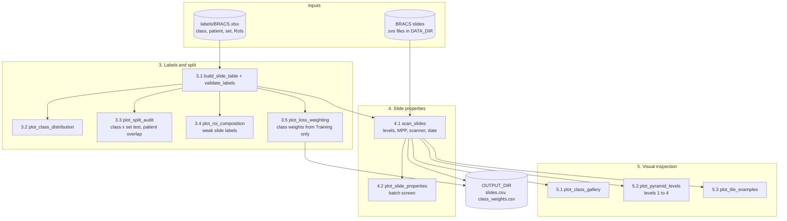
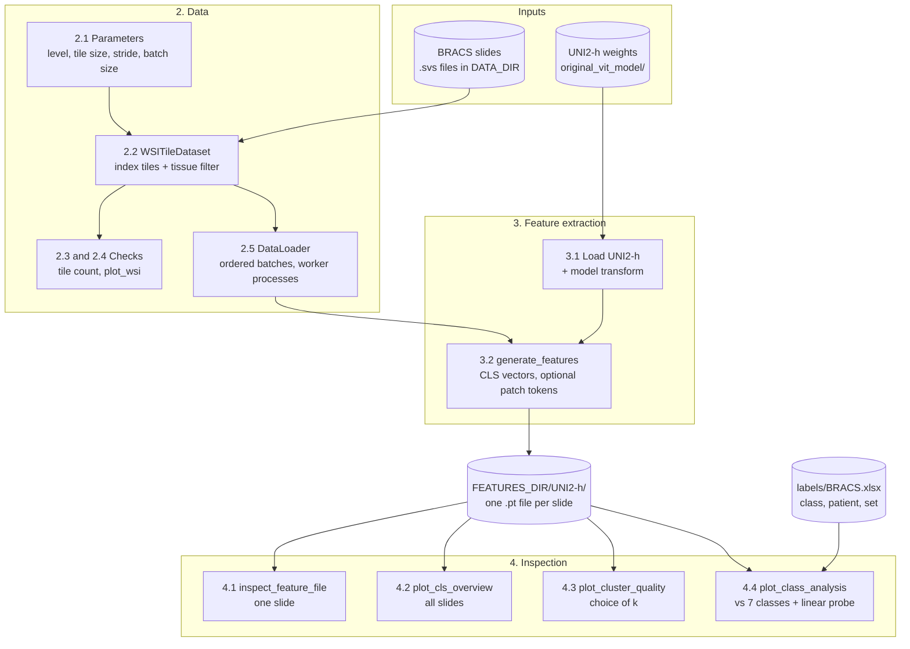
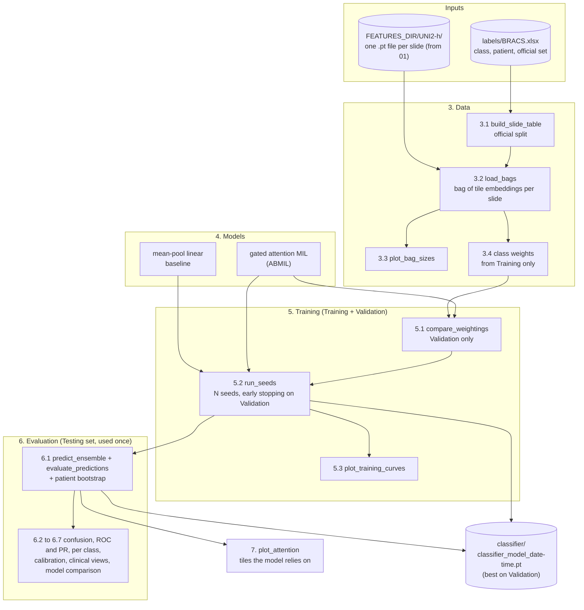

# phd-streamembed

Turn whole-slide pathology images (WSIs) into compact tile embeddings with the foundation model **UNI2-h**, so they can be used later for classification. Developed on the BRACS breast-cancer slide data set (547 slides, 189 patients, 7 diagnostic classes).

Slides are gigapixel images, far too large to feed to a network at once. The pipeline cuts each slide into small tiles, drops empty background, embeds each tile and writes the vectors to disk **one file per slide**, processing the data tile by tile and slide by slide so memory use stays small.

## Notebooks

The work is organised as numbered notebooks. Each one keeps its code thin; the logic lives in `utils/`. Every figure carries its own caption, and every code cell has a markdown cell before it.

| notebook | purpose | status |
|---|---|---|
| `00_data_visualization.ipynb` | the data set: labels, audit of the official split, slide properties, pyramid levels, class weights | done |
| `01_wsi_to_vectors.ipynb` | slides to tile embeddings, and inspection of the embeddings | done |
| `02_vectors_to_classifier.ipynb` | PyTorch classifier (multiple-instance learning) on the saved vectors, with a full set of metrics on the official Testing set | done |
| `03_reidentification_risk_assessment.ipynb` | re-identification risk assessment | planned (empty) |

## The data set

- **Slides and labels.** The `.svs` slides go in `DATA_DIR`; `labels/BRACS.xlsx` holds, for every slide, the class, the patient and the official set (Training / Validation / Testing), plus the regions of interest (RoIs) of each slide.
- **Seven classes**, from benign to malignant: **N** normal, **PB** pathological benign, **UDH** usual ductal hyperplasia, **FEA** flat epithelial atypia, **ADH** atypical ductal hyperplasia, **DCIS** ductal carcinoma in situ, **IC** invasive carcinoma. They can be read as four tiers: no finding (N), benign (PB, UDH), atypical / high risk (FEA, ADH) and malignant (DCIS, IC). Definitions are in section 3.1 of `00_data_visualization.ipynb`.
- **A slide label is the highest-grade RoI of the slide**, so slides also contain lower-grade tissue (a slide labelled IC has about 61% IC regions on average). The label describes the tissue sample, not the person: 78 of 189 patients have slides of several classes.
- **The official split is used unchanged**, so results stay comparable with published BRACS work. Its audit (notebook 00, section 3.3): the class mix of the three sets does not differ significantly from a random assignment of patients (Cramér's V 0.15, permutation p = 0.47), but the Validation and Testing sets are small, and one patient (67) has slides in both Training and Validation.
- **Class imbalance** (Training: PB 120 and IC 100 slides against FEA 24): class weights for the loss are computed on the Training set only (`utils/class_weights.py`) and saved to `class_weights.csv`.
- **Technical properties.** All slides come from one scanner (SS7212, 40x); scan year is moderately associated with class (Cramér's V 0.27), which is a possible batch effect. Twelve slides have no pyramid level 4, and level 4 is downsampled 32x or 64x depending on the slide.

## How it works

```
.svs slide ──► tiles (224x224) ──► drop background ──► UNI2-h ──► <slide>.pt
              at one pyramid level   tissue filter       per tile:   CLS vector (1536-d)
                                                                     + optional 16x16 patch tokens
```

1. **Tile** each slide at a chosen pyramid level (`WSITileDataset`, `utils/dataset.py`).
2. **Filter** tiles that are mostly white or black (`background_filter`, `utils/clean_empty.py`).
3. **Embed** batches of tiles with UNI2-h (`utils/load_model.py`, `utils/transformer_per_model.py`).
4. **Save** features per slide (`generate_features`, `utils/generate_features.py`).
5. **Inspect** one file or all slides (`utils/inspect_features.py`, `utils/cls_overview.py`), choose the number of clusters (`utils/cluster_quality.py`) and compare the embeddings with the 7 classes (`utils/class_analysis.py`, labels from `labels/BRACS.xlsx`).

Steps 1 to 5 are in `01_wsi_to_vectors.ipynb`. The classifier that uses the embeddings is in `02_vectors_to_classifier.ipynb` (see below).

## Output format

One PyTorch file per slide: `<FEATURES_DIR>/<model>/<slide_stem>.pt`, a dict with

| key | shape / type | content |
|---|---|---|
| `cls_features` | `[tiles, 1536]` | one summary vector per tile |
| `patch_features` | `[tiles, 256, 1536]` | 16x16 patch tokens per tile; only saved with `save_patch_features=True` |
| `coordinates` | `[tiles, 2]` | `(x, y)` of each tile, in pixels of the tiled pyramid level |
| `model_encoder` | `str` | model name, e.g. `UNI2-h` |
| `tile_params` | `dict` | `level`, `tile_size`, `stride` and the tile filter with its arguments |

Patch tokens make up about 99% of the file size (a slide with 355 tiles is about 560 MB with them and about 2 MB without), so `save_patch_features=False` is the sensible choice when only a classifier on CLS vectors is planned.

Load a file with `torch.load(path, weights_only=True)`.

## The classifier

A slide is a bag of tile embeddings with one label, so classification is **multiple-instance learning**. `02_vectors_to_classifier.ipynb` trains two PyTorch models on the CLS embeddings and the 7 classes of `labels/BRACS.xlsx`:

- a **baseline** that averages the tile embeddings of a slide and applies one linear layer;
- a **gated attention MIL model** (ABMIL, Ilse et al., 2018) that learns a weight for every tile, pools the tiles with these weights and classifies the result; its attention can be drawn on the slide.

Protocol: the official split is used unchanged. Training slides fit the models, Validation slides are used for every choice (loss weighting, epoch), and the Testing set is evaluated once, at the end (the training code never receives Testing labels). The loss is the class-weighted cross-entropy with weights from the Training counts. Every model is trained with several seeds; the predictions of the seeds are averaged. One `SEED` fixes every random choice, and the code picks the GPU if there is one and the CPU otherwise.

Reported on the Testing set, with 95% patient-level bootstrap intervals: accuracy, balanced accuracy, macro and weighted F1, per-class precision, recall and F1, the confusion matrix, one-vs-rest AUROC and average precision (ROC and precision-recall curves), quadratic-weighted kappa, Matthews correlation, top-2 accuracy, log-loss, Brier score and calibration error, plus two clinical views derived from the seven class probabilities (three tiers; cancer against non-cancer) and a paired comparison of the two models. Results are shown in the notebook and not written to disk. The only file written is the best classifier (highest Validation macro-F1 over both models and seeds, never chosen on the Testing set) as `classifier/classifier_model_<date-time>.pt`, with weights, class names, feature scaler, settings and Validation result; `utils.mil_train.load_classifier` loads it.

## Setup

Requirements: Python >= 3.14, [uv](https://docs.astral.sh/uv/), the system library **libvips** (used through `pyvips`), and a GPU is recommended for feature extraction. Notebook 00 needs no GPU and no model; notebook 02 trains on a GPU if there is one and otherwise on the CPU (slower, same results up to floating-point differences).

```bash
uv sync                      # install the dependencies from pyproject.toml / uv.lock
uv run jupyter lab           # open the notebooks
```

**Model weights.** UNI2-h is gated on Hugging Face. Request access to [MahmoodLab/UNI2-h](https://huggingface.co/MahmoodLab/UNI2-h), log in with `huggingface-cli login`, then run

```bash
uv run python setup_only/model_download.py   # downloads into original_vit_model/
```

**Data.** Put the `.svs` slides in one flat folder and set `DATA_DIR` in the notebooks. Two helper scripts in `setup_only/` prepare it (edit the CONFIG block at the top of each first):

- `flatten_copy.py` copies all files of a folder tree into one flat folder.
- `rsync_upload.py` uploads the slides to a remote workstation (`--dry-run` lists what would be sent).

The label sheet `labels/BRACS.xlsx` is read with the standard library (no `openpyxl` needed). `scikit-learn` provides the evaluation metrics of notebook 02.

## Usage

Run the notebooks from the top, from the repository root.

**`00_data_visualization.ipynb`** (section 2): `DATA_DIR`, `LABELS_FILE`, `OUTPUT_DIR`, `TILE_SIZE`, `TILE_EXAMPLE_LEVEL` and `SEED`. It writes `slides.csv` (one row per slide: label, patient, set, technical properties) and `class_weights.csv` (loss weights from the Training counts) to `OUTPUT_DIR`. A full run takes about ten seconds on the local data.

**`01_wsi_to_vectors.ipynb`** (section 2.1):

| parameter | meaning |
|---|---|
| `PYRAMID_LEVEL` | resolution to tile from: 1 is full resolution, higher is more downsampled |
| `TILE_SIZE`, `STRIDE` | tile side in pixels (224 for UNI2-h); `STRIDE == TILE_SIZE` means no overlap |
| `BATCH_SIZE` | tiles per model call |
| `DATA_DIR`, `FEATURES_DIR` | slide folder and output folder |

**`02_vectors_to_classifier.ipynb`** (section 2): `FEATURES_DIR`, `MODEL_NAME`, `LABELS_FILE`, `MODEL_DIR`, `SAVE_BEST_MODEL`, `SEED`, `N_SEEDS`, `EPOCHS`, `PATIENCE`, `LR`, `WEIGHT_DECAY`, `BATCH_SIZE`, `MAX_TILES_TRAIN` (tiles per slide per epoch) and `N_BOOT`. Needs the feature files from notebook 01 (with `cls_features`; patch tokens are not used) and takes minutes on a GPU for features tiled at level 3.

The number of tiles grows roughly 16-fold per pyramid level step towards level 1, and runtime and disk use grow with it. At level 3 the BRACS slides give about 94k tiles.

Helpers, usable from any notebook:

```python
from utils.dataset_overview import build_slide_table, plot_split_audit
from utils.class_weights import plot_loss_weighting, weighted_cross_entropy
from utils.plot_pyramid import plot_pyramid_levels
from utils.plot_wsi import plot_wsi
from utils.inspect_features import inspect_feature_file
from utils.cls_overview import plot_cls_overview
from utils.cluster_quality import plot_cluster_quality
from utils.class_analysis import plot_class_analysis
from utils.mil_data import load_bags
from utils.mil_train import run_seeds, predict_ensemble
from utils.classification_metrics import evaluate_predictions, patient_bootstrap

table = build_slide_table("labels/BRACS.xlsx")                          # slide, patient, class, set
plot_split_audit(table)                                                 # is the official split sound?
plot_loss_weighting(y_train, ["N", "PB", "UDH", "FEA", "ADH", "DCIS", "IC"])   # class weights and their effect
plot_pyramid_levels("data/BRACS_1003658.svs")                           # same tissue at levels 1 to 4
plot_wsi(dataset, slide=0)                                              # tiling of one slide
inspect_feature_file(features_dir=FEATURES_DIR, model_name="UNI2-h")    # one .pt file
plot_cls_overview(FEATURES_DIR, "UNI2-h", n_clusters=7)                 # all slides
plot_cluster_quality(FEATURES_DIR, "UNI2-h")                            # which k? (silhouette, stability)
plot_class_analysis(FEATURES_DIR, "UNI2-h", "labels/BRACS.xlsx")       # embeddings vs the 7 classes, linear probe
data = load_bags(FEATURES_DIR, "UNI2-h", table)                         # bags of tile embeddings, one per slide
runs = run_seeds("abmil", [0, 1, 2], data, None, device)                # train the attention model (see notebook 02)
```

## Data pipeline per notebook

One diagram per notebook, in notebook order, drawn from its inputs to its outputs. Cylinders are data on disk, boxes are processing steps (numbers are the notebook sections). Add the diagram of each new notebook here when it is created.

### `00_data_visualization.ipynb`: the data set (labels, split, slides)



The official Training/Validation/Testing split is used unchanged (comparable with published BRACS results). Its properties are documented in section 3.3: the class mix of the sets does not differ significantly from a random assignment of patients, one patient has slides in two sets, and 78 of 189 patients have slides of more than one class. The loss weights are computed on the Training set only.

- **Input:** `labels/BRACS.xlsx` and the `.svs` slides (headers only; pixels are read for the figures in section 5).
- **Output:** `slides.csv` and `class_weights.csv`, plus the figures documenting the data. Later notebooks read these tables, so the split and the weights are the same everywhere.

### `01_wsi_to_vectors.ipynb`: slides to tile embeddings



- **Input:** `.svs` slides, the UNI2-h checkpoint and, for section 4.4, `labels/BRACS.xlsx`.
- **Output:** per-slide `.pt` files (`cls_features`, `coordinates`, `model_encoder`, `tile_params`, optional `patch_features`); the figures in section 4 are for checking only.

### `02_vectors_to_classifier.ipynb`: embeddings to a slide classifier



- **Input:** the per-slide feature files of notebook 01 and `labels/BRACS.xlsx`.
- **Output:** the results are shown in the notebook; the only file written is the best classifier with its configuration (seeds, selected weighting, tiling, versions, device). The Testing labels are used only in section 6.

### Planned notebooks

| notebook | purpose | diagram |
|---|---|---|
| `03_reidentification_risk_assessment.ipynb` | re-identification risk assessment | to be added |

## Repository layout

```
00_data_visualization.ipynb   data set: labels, split audit, slide properties, class weights
01_wsi_to_vectors.ipynb       tiling -> embedding -> inspection
02_vectors_to_classifier.ipynb  MIL classifier on the embeddings, metrics on the Testing set
03_reidentification_risk_assessment.ipynb   planned (empty)
labels/BRACS.xlsx             slide labels, patients, official split, RoIs
outputs/                      tables written by notebook 00 (slides.csv, class_weights.csv)
classifier/                   best classifier saved by notebook 02 (classifier_model_<date-time>.pt)
utils/                        code, by role:
    pipeline          dataset, clean_empty, transformer_basic, transformer_per_model, dataloader,
                      load_model, device, generate_features
    classifier        mil_data, mil_models, mil_train, classification_metrics, plot_classification
    data set          labels, slide_stats, dataset_overview, class_weights, plot_pyramid
    embeddings        plot_wsi, inspect_features, cls_data, cls_overview, cluster_quality, class_analysis
    figures           figure_captions (the caption under each panel)
setup_only/                   one-off scripts: model download, flatten data, rsync upload
original_vit_model/           UNI2-h weights (not versioned)
data/                         slides (not versioned)
```

## Notes and limitations

- Tiles of a slide must arrive together and in order (`shuffle=False`), because features are written slide by slide.
- Slides without the requested pyramid level are skipped (12 slides at level 4); tiles with damaged image data are left out. Both are reported as warnings after indexing.
- Re-running overwrites existing `.pt` files of the same slide name.
- Augmentation and the model-specific transform settings are not stored in the output files.
- Slide labels are weak labels for tiles (see above); class separation is therefore assessed at slide level.
- The class weights fix the loss, not the evaluation: report balanced accuracy and per-class recall on the untouched Validation and Testing sets.
- Notebook 02 evaluates on the official Testing set only once; with 87 Testing slides and classes of 7 to 20 slides, intervals are wide and small differences between models cannot be resolved. Slides without a feature file (for example without pyramid level 4) shrink the sets and are reported.
- The loss weights shift the output probabilities towards the rare classes, so the probabilities are not calibrated to the true class frequencies.
- Scan year is associated with class (Cramér's V 0.27); check for batch effects before interpreting classifier results.
