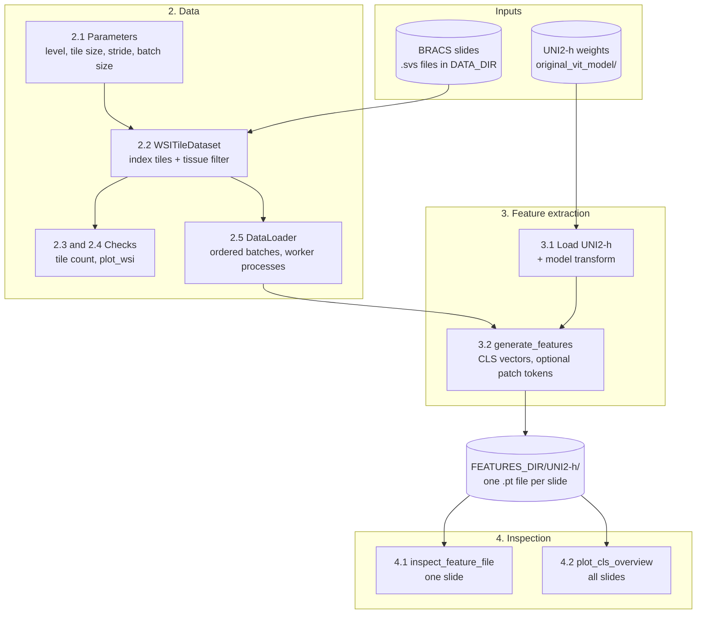

# phd-streamembed

Turn whole-slide pathology images (WSIs) into compact tile embeddings with the foundation model **UNI2-h**, so they can be used later for classification. Developed on the BRACS breast-cancer slide dataset.

Slides are gigapixel images, far too large to feed to a network at once. The pipeline cuts each slide into small tiles, drops empty background, embeds each tile and writes the vectors to disk **one file per slide**, processing the data tile by tile and slide by slide so memory use stays small.

## How it works

```
.svs slide ──► tiles (224x224) ──► drop background ──► UNI2-h ──► <slide>.pt
              at one pyramid level   tissue filter       per tile:   CLS vector (1536-d)
                                                                     + optional 16x16 patch tokens
```

1. **Tile** each slide at a chosen pyramid level (`WSITileDataset`, `utils/dataset.py`).
2. **Filter** tiles that are mostly white or black (`background_filter`, `utils/clean_empty.py`).
3. **Embed** batches of tiles with UNI2-h (`utils/load_model.py`, `utils/transformer_per_model.py`).
4. **Save** features per slide (`generate_features`, `utils/generate_features.py`).
5. **Inspect** one file or all slides (`utils/inspect_features.py`, `utils/cls_overview.py`).

The whole workflow is in the notebook `01_wsi_to_vectors.ipynb`.

## Output format

One PyTorch file per slide: `<FEATURES_DIR>/<model>/<slide_stem>.pt`, a dict with

| key | shape / type | content |
|---|---|---|
| `cls_features` | `[tiles, 1536]` | one summary vector per tile |
| `patch_features` | `[tiles, 256, 1536]` | 16x16 patch tokens per tile; only saved with `save_patch_features=True` |
| `coordinates` | `[tiles, 2]` | `(x, y)` of each tile, in pixels of the tiled pyramid level |
| `model_encoder` | `str` | model name, e.g. `UNI2-h` |
| `tile_params` | `dict` | `level`, `tile_size`, `stride` and the tile filter with its arguments |

Patch tokens make up about 99% of the file size (a slide with 355 tiles is about 560 MB with them and about 2 MB without), so `save_patch_features=False` is the sensible choice when only a classifier on CLS vectors is planned.

Load a file with `torch.load(path, weights_only=True)`.

## Setup

Requirements: Python >= 3.14, [uv](https://docs.astral.sh/uv/), the system library **libvips** (used through `pyvips`), and a GPU is recommended.

```bash
uv sync                      # install the dependencies from pyproject.toml / uv.lock
uv run jupyter lab           # open 01_wsi_to_vectors.ipynb
```

**Model weights.** UNI2-h is gated on Hugging Face. Request access to [MahmoodLab/UNI2-h](https://huggingface.co/MahmoodLab/UNI2-h), log in with `huggingface-cli login`, then run

```bash
uv run python setup_only/model_download.py   # downloads into original_vit_model/
```

**Data.** Put the `.svs` slides in one flat folder and set `DATA_DIR` in the notebook. Two helper scripts in `setup_only/` prepare it (edit the CONFIG block at the top of each first):

- `flatten_copy.py` copies all files of a folder tree into one flat folder.
- `rsync_upload.py` uploads the slides to a remote workstation (`--dry-run` lists what would be sent).

## Usage

Run `01_wsi_to_vectors.ipynb` from the top. The main settings are in section 2.1:

| parameter | meaning |
|---|---|
| `PYRAMID_LEVEL` | resolution to tile from: 1 is full resolution, higher is more downsampled |
| `TILE_SIZE`, `STRIDE` | tile side in pixels (224 for UNI2-h); `STRIDE == TILE_SIZE` means no overlap |
| `BATCH_SIZE` | tiles per model call |
| `DATA_DIR`, `FEATURES_DIR` | slide folder and output folder |

The number of tiles grows roughly 16-fold per pyramid level step towards level 1, and runtime and disk use grow with it. At level 3 the BRACS slides give about 94k tiles.

Inspection helpers, usable from the notebook:

```python
from utils.plot_wsi import plot_wsi
from utils.inspect_features import inspect_feature_file
from utils.cls_overview import plot_cls_overview

plot_wsi(dataset, slide=0)                                             # tiling of one slide
inspect_feature_file(features_dir=FEATURES_DIR, model_name="UNI2-h")   # one .pt file
plot_cls_overview(FEATURES_DIR, "UNI2-h")                              # all slides
```

## Data pipeline per notebook

One diagram per notebook, drawn from its inputs to its outputs. Cylinders are data on disk, boxes are processing steps (numbers are the notebook sections). Add the diagram of each new notebook here when it is created.

### `01_wsi_to_vectors.ipynb`: slides to tile embeddings



- **Input:** `.svs` slides and the UNI2-h checkpoint.
- **Output:** per-slide `.pt` files (`cls_features`, `coordinates`, `model_encoder`, `tile_params`, optional `patch_features`); the figures in section 4 are for checking only.

### Planned notebooks

| notebook | purpose | diagram |
|---|---|---|
| `00_data_visualization.ipynb` | look at the data | to be added |
| `02_vectors_classifier.ipynb` | classifier on the saved vectors | to be added |
| `03_reidentification_risk_assessment.ipynb` | re-identification risk assessment | to be added |

## Repository layout

```
01_wsi_to_vectors.ipynb   main notebook: tiling -> embedding -> inspection
utils/                    pipeline code (dataset, filter, transforms, loader, model, features, plots)
setup_only/               one-off scripts: model download, flatten data, rsync upload
original_vit_model/       UNI2-h weights (not versioned)
data/                     slides (not versioned)
```

## Notes and limitations

- Tiles of a slide must arrive together and in order (`shuffle=False`), because features are written slide by slide.
- Slides without the requested pyramid level are skipped; tiles with damaged image data are left out. Both are reported as warnings after indexing.
- Re-running overwrites existing `.pt` files of the same slide name.
- Augmentation and the model-specific transform settings are not stored in the output files.
